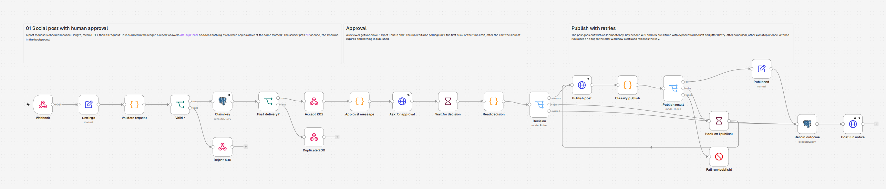
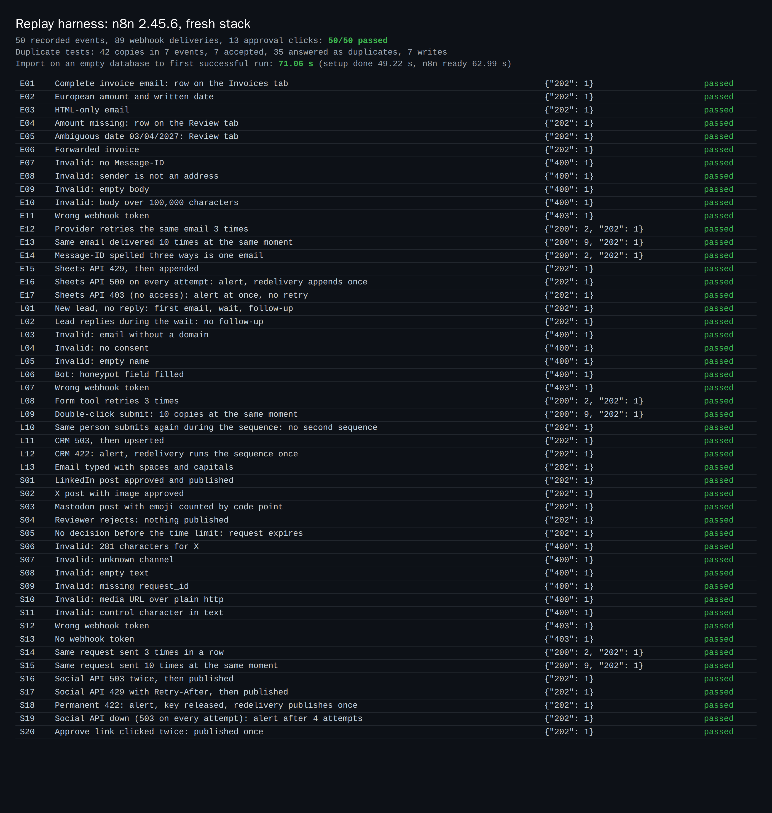
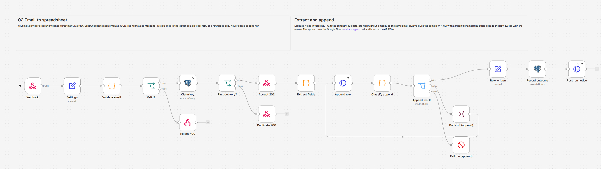
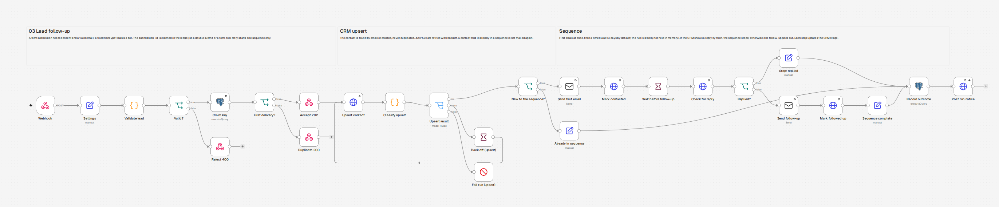
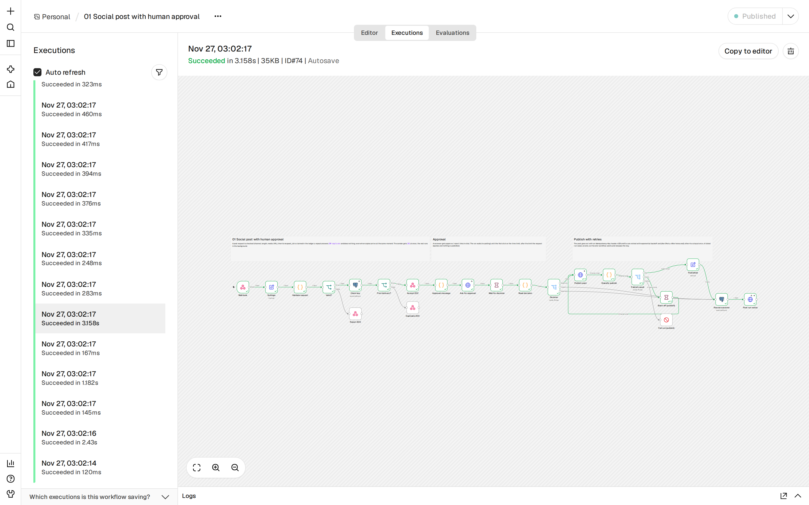
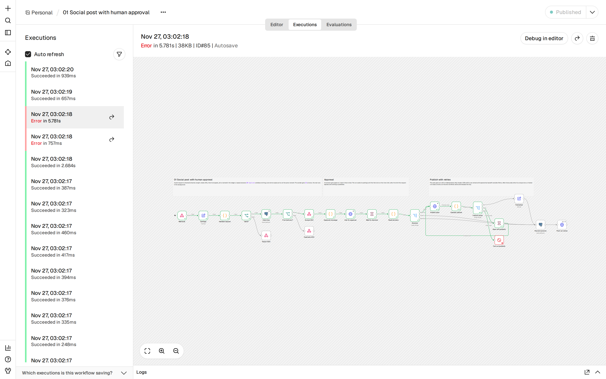
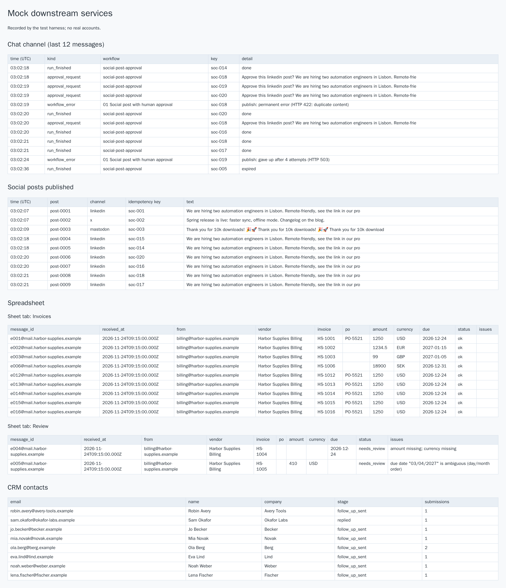
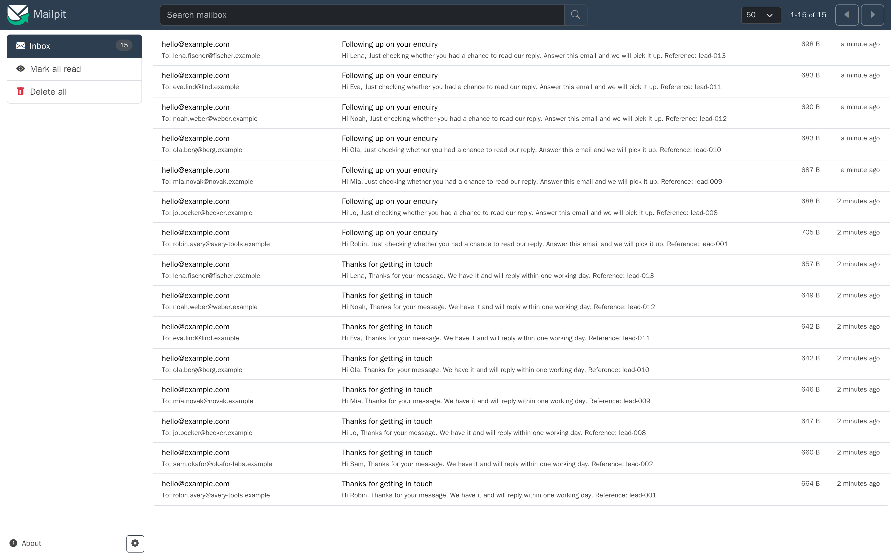

# n8n Workflow Pack: three production-ready workflows with tests

[](https://github.com/ali-fakhrabadi/n8n-workflow-pack/actions/workflows/ci.yml)

Three import-ready [n8n](https://n8n.io) workflows built to survive real use. Each validates
its input, never runs twice for the same event (even when ten copies arrive at once), retries
what is worth retrying, and reports its own failures. A replay harness proves it: it imports
the workflows into a fresh n8n in Docker, replays 50 recorded events against mock services
and checks every result.

| # | Workflow | In | Out |
|---|---|---|---|
| 01 | **Social post with human approval** | post request (webhook) | approve / reject links in chat → published post |
| 02 | **Email to spreadsheet** | inbound email JSON (Postmark, Mailgun, SendGrid style) | invoice fields as a sheet row, doubtful ones on a Review tab |
| 03 | **Lead follow-up sequence** | form submission (webhook) | CRM contact, first email, timed wait, follow-up unless they replied |
| 00 | **Error handler** | any failed run of 01-03 | ledger released for redelivery, alert with ids in chat |

> Independent reference project with synthetic data (invented people and companies on
> `example` domains). It is not client work. All outside services are mocked in the tests: no
> real social, email, sheet or CRM accounts are used.



## Results

Measured by [`tests/harness/run.sh`](tests/harness/run.sh) on n8n 2.45.6: four full runs on
fresh stacks on a lab VM (10 vCPU, shared with other services) and the CI run on a GitHub
Actions runner, images already pulled. Reports and ledgers are in
[`docs/results/`](docs/results).

| What | Result |
|---|---|
| Recorded events replayed | **50** per run (20 social, 17 email, 13 lead), **50/50 passed in all 5 runs** |
| HTTP deliveries per run | 89 webhook calls, plus 13 approval clicks (14 in CI, one early click repeated) |
| Duplicate-run tests | 42 copies of 7 events sent (30 of them as 10 simultaneous copies) → **7 accepted, 35 answered as duplicates, 7 writes**: no duplicate post, row, contact or email |
| Import to first successful run on a fresh n8n | lab VM: **68.05 s, 68.47 s, 68.80 s, 71.06 s**; GitHub runner: **32.44 s** (empty database → migrations, credentials, 4 workflows imported and published → first event processed) |
| Retries | 503 ×2 then success: published on attempt 3; 429 with `Retry-After`: appended/published on attempt 2 |
| Failures | 3 permanent errors (one 403, two 422) and 2 outages (4 failed attempts each): all 5 raised an alert with workflow, node and key and released the key; the 3 redelivered after the service recovered ran once each |
| Approval | a second click on the same approve link got `409`; still one post. A click in the instant before the run waits also gets `409` and must be repeated ([why](docs/workflows.md#01-social-post-with-human-approval)) |
| Code node unit tests | 20 passing (`node --test tests/unit/*.test.mjs`) |

The mocks do not de-duplicate anything, so any duplicate run would have shown as a second
post, row or CRM upsert. What the first runs caught before these numbers is in
[docs/testing.md](docs/testing.md#what-the-harness-found).



## What every workflow does

```
webhook (token) → Settings → Validate ──invalid──▶ 400 + reason
                                 │
                       Claim key in PostgreSQL ──already seen──▶ 200 {"duplicate": true}
                                 │
                                202 ─▶ work ─▶ outbound call ─▶ Classify ─┬─ ok ──▶ Record outcome ─▶ notice
                                                   ▲                       ├─ retry (429/5xx/no answer): back off, call again
                                                   └───────────────────────┘
                                                                           └─ failed ─▶ Stop and Error ─▶ 00 Error handler
```

- **Input validation** in tested Code nodes: required fields, formats, size limits, channel
  length rules, consent, a honeypot field; invalid input changes nothing.
- **Idempotency** with one atomic statement on a PostgreSQL ledger
  (`INSERT … ON CONFLICT … DO UPDATE … WHERE status = 'failed' RETURNING`): the first copy runs,
  the rest are answered as duplicates, and a failed event can be redelivered.
- **Retries** with exponential backoff, jitter and `Retry-After`; permanent errors stop at
  once. Every create call also sends an `Idempotency-Key` header.
- **Error workflow**: marks the run's key `failed` (so it can be redelivered) and alerts with
  ids only, never the payload.

Details per workflow and node: [docs/workflows.md](docs/workflows.md).

| Email to spreadsheet | Lead follow-up |
|---|---|
|  |  |

| A retried publish that succeeded | An outage: run failed, alert raised |
|---|---|
|  |  |

What the mocks recorded after a run (chat, posts, sheet tabs, CRM) and the follow-up emails:

| Mock services | Mailpit |
|---|---|
|  |  |

## Run the tests

Needs Docker with Compose v2 (and Node 22 / Python 3.12 for the fast checks).

```bash
tests/harness/run.sh                      # fresh stack, 50 events, report in tests/harness/out/
node --test tests/unit/*.test.mjs                    # Code node unit tests
python3 scripts/build_workflows.py --check
```

Keep the stack and open the editor on `127.0.0.1:5678`:

```bash
HARNESS_KEEP=1 HARNESS_EDITOR=1 tests/harness/run.sh
```

CI runs all of it on every push, including the full harness. How the harness works:
[docs/testing.md](docs/testing.md).

## Use the workflows

Import the four files in [`workflows/`](workflows) (error handler first), create the ledger
table from [`setup/ledger.sql`](setup/ledger.sql), create four credentials and set the
**Settings** node of each workflow, or let [`setup/setup.mjs`](setup/setup.mjs) do it from
Docker secrets. Step by step, and how to swap each mock for Slack, LinkedIn, Google Sheets,
HubSpot and so on: [docs/import-guide.md](docs/import-guide.md).

## Repository

| Path | Contents |
|---|---|
| `workflows/` | The four n8n exports (generated; no credential values) |
| `src/code/` | Code node sources, embedded by `scripts/build_workflows.py` |
| `setup/` | Setup script, ledger schema, PostgreSQL init, task-runner config |
| `mocks/mock_sinks.py` | Mock chat, social, spreadsheet and CRM APIs (stdlib Python) |
| `tests/events/` | The 50 recorded synthetic events and their generator |
| `tests/harness/` | Replay harness, run script, screenshot tooling |
| `tests/unit/` | Code node unit tests |
| `docs/` | Workflow reference, import guide, testing, recorded results, plan |

## Security

- Webhooks require a token header; n8n rejects a wrong or missing one with `403` before any
  node runs.
- Containers run read-only with all capabilities dropped; Code nodes run in n8n's external
  task runner, without database credentials or the encryption key and with no modules
  allowed; n8n's SSRF protection is on, with only the mock hosts allowed among private
  addresses, and the test network has no internet access.
- The ledger role can only `SELECT, INSERT, UPDATE` its one table.
- Secrets are Docker secrets, generated per harness run; the exports reference credentials by
  id only. CI scans the full history with gitleaks.
- Alerts and the ledger hold ids and short messages, not payloads.

## License

[MIT](LICENSE)
